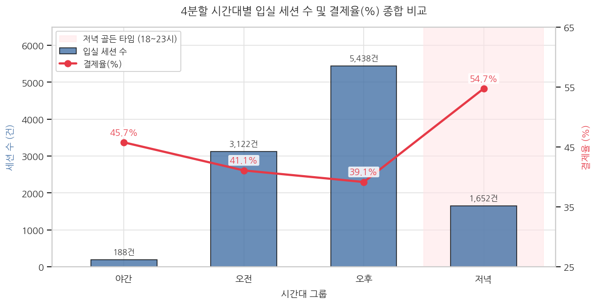
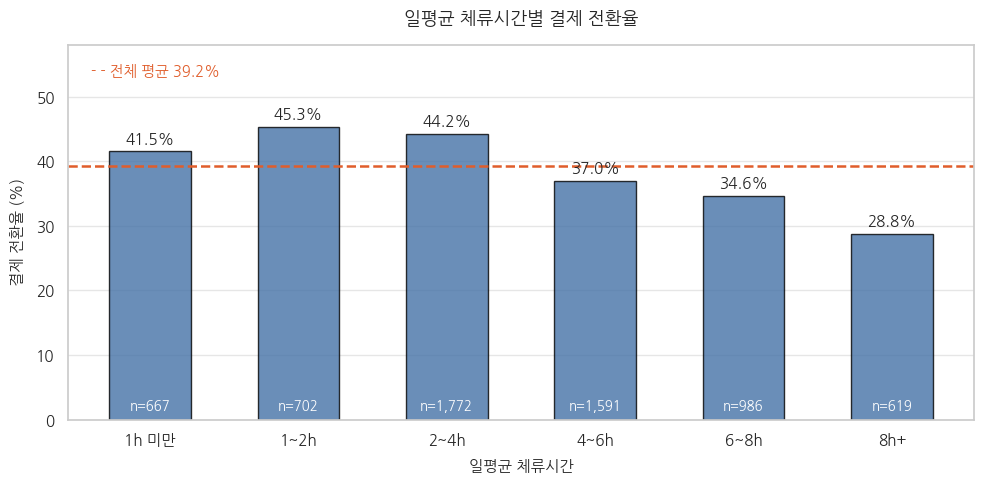

# 공유오피스 무료체험 운영 최적화를 위한 수요 및 결제 전환 예측 분석

> 무료체험 이용은 오후에 52.3%가 몰렸지만 결제 전환율은 저녁(54.7%)이 오후(39.1%)보다 높았고, 오래 머물수록이 아니라 일평균 1-4시간 이용자(44-45%)와 재방문한 이용자에서 전환율이 높았다.

- 📄 [분석 보고서 (PDF)](reports/report.pdf) · 📊 [발표자료 (PDF)](reports/presentation.pdf) · 📓 [분석 노트북](notebooks/shared_office_trial_conversion_analysis.ipynb)
- **기간**: 2026.09.11 – 2026.09.29
- **인원**: 팀 5인 (클래스 불균형팀: 곽수연, 김채현, 박고은, 송용진, 신예원)
- **도구**: Python (pandas, scikit-learn, XGBoost, LightGBM)

## 문제 정의

공유오피스 3일 무료체험은 잠재 고객이 유료 멤버십 가입을 판단하는 단계지만, 신청자 수와 전체 전환율만으로는 운영을 개선하기 어렵습니다.
무료체험 수요가 언제·어디에 몰리는지, 체류시간·방문일수·재방문 같은 이용행태가 결제 전환과 어떤 관계가 있는지를 확인하고,
이를 바탕으로 무료체험 운영 정책을 어떻게 바꿔야 전환율을 높일 수 있는지 근거를 마련하고자 했습니다.

## 분석 과정

- **전처리·세션 복원**: 출입 로그를 KST로 통일하고 중복·이상치를 제거했습니다. 자정 기준으로 쪼개진 방문 기록 1,351행을 분류해 1박 이용 868행은 434행으로 복원하고, 2-3박 장기체류 이상치(250행)와 짝 없는 단독 로그(233행)는 삭제했습니다. 그 결과 세션 테이블 10,402행과 유저별 집계 테이블 6,335명을 만들었습니다.
- **EDA**: 시간대·요일·지점·체류시간·방문일수별 이용량과 결제 전환율을 비교했습니다.
- **1차 모델링 (수요 예측)**: 지점·요일·시간대별 동시 체류 인원을 1시간 → 4구간 → 요일 단위 회귀로 예측했고, 정밀한 인원 예측이 어려워 `수요없음/보통/높음` 3단계 등급 분류로 전환했습니다. 4구간 Random Forest(Macro F1 0.544)를 1차 최종 모델로 채택했습니다.
- **2차 모델링 (결제 전환 예측)**: 기본 행동 변수에 이용도 등급(level), 재방문 여부(dropout), 체류시간 변화량(stay_growth)을 단계적으로 추가하며 Random Forest로 결제 전환을 예측했습니다. 2023-09-01 기준으로 학습/검증을 시점 분리했습니다.

## 핵심 결과

  
  

- **이용이 몰리는 시간대와 전환율이 높은 시간대가 달랐습니다.** 오후(12-17시)에 방문의 52.3%가 집중됐지만 전환율은 39.1%로 가장 낮았고, 방문 비중 15.9%인 저녁(18-23시)은 54.7%로 가장 높았습니다.
- **체류시간과 전환율은 비선형 관계였습니다.** 세션 기준 30분-2시간 구간의 전환율이 53%대로 가장 높았고, 일평균 8시간 이상 이용자는 28.8%까지 떨어졌습니다.
- **방문일수가 늘수록 전환율이 올랐습니다.** 1일 34.0%, 2일 42.6%, 3일 49.2%였고, 재방문 유저(45.4%)와 재방문 포기 유저(33.9%)의 차이는 11.5%p였습니다.
- **결제 전환 모델의 AUC는 기본 변수 0.602 → 이용도 등급 추가 0.627 → 재방문 여부 추가 0.640으로 개선됐습니다.** 변수 중요도는 체류시간 40.8%, 재방문 여부 14.6% 순이었습니다. 최종 모델은 해석력을 위해 stay_growth를 포함한 Random Forest(AUC 0.637)로 정했습니다.
- 지점별 전환율(34-44%) 차이는 운영일수와 복수 지점 이용자 비중의 영향이 커서, 지점 자체의 품질 차이로 보기는 어려웠습니다.

## 제안

1. **체류시간 기반 운영 개선**: 체류 4시간 경과 시점에 유료 멤버십·요금제 안내를 자동 발송하고, 1-2시간 중심의 집중 체험 프로그램을 별도로 운영합니다.
2. **시간대 기반 운영 전략**: 저녁 시간대 추천 노출 효과를 A/B 테스트로 확인하고, 오후 피크 시간에는 예약제·신청 인원 조정·혼잡 안내를 시범 적용합니다.
3. **재방문 유도 전략**: 연속 3일 체험을 "신청 후 10일 이내 원하는 3일 선택" 방식으로 유연화하고, 첫 방문 후 리마인더와 2일 이상 방문자 대상 전환 혜택을 제공합니다.
4. **무료체험 설계 개선**: 3일·2일·선택형 체험을 비교하는 A/B 테스트를 진행하고, 신청 단계에서 희망 방문일과 목적을 받아 미방문(34.2%)을 줄입니다.
5. **지점 운영 전략**: 전 지점 공통 서비스 기준을 세우고, 신규 지점은 운영일수를 고려한 별도 지표로 평가합니다.

> 본 분석은 이용행태와 결제 전환의 관계를 관찰한 것이므로, 각 제안은 A/B 테스트로 효과를 검증하며 단계적으로 적용하는 것을 전제로 합니다.

## 내 역할

- access 테이블의 UTC 기준 시간대임을 발견 후 KST 기준으로 변경
- 결제 전환 EDA: 결제/미결제 비율과 지점·요일·입실 시간대·일평균 체류시간·총(3일) 체류시간·방문일수별 이용자 수 및 결제 전환율을 비교하여, 오래 머문 유저일수록 오히려 결제율이 낮고 방문일수가 늘수록 결제율이 높아지는 패턴 확인
- 1차 모델링
- PPT 제작

## 한계와 배운 점

**한계**
- 결제 시점 데이터가 없어 이용행태가 결제 이전에 일어난 것인지 구분할 수 없었고, 결과를 인과효과로 해석할 수 없습니다.
- 유료 회원의 출입 기록이 없어 이용도 등급은 공간 전체가 아닌 무료체험 이용자만 기준으로 한 수요 수준입니다. '높음' 등급도 실제 동시 체류 인원은 평균 1-2명이었습니다.
- 최종 모델의 AUC는 약 0.64로 개인 단위 정밀 예측에는 한계가 있어, 결제 가능성이 높은 고객군을 넓게 선별하는 보조 도구로 활용하는 것이 적절합니다.
- Train/Test 기간의 결제 전환율이 41.2%와 27.2%로 14.0%p 차이가 나, 분포 변화가 성능에 영향을 줬을 수 있습니다.

**배운 점**
- 하이퍼파라미터 튜닝과 6가지 모델군 비교에도 AUC가 0.58-0.63 범위에 머물렀습니다. 성능 한계가 모델 선택보다 변수의 설명력에서 온다는 것을 확인했고, 모델을 바꾸기 전에 어떤 정보가 데이터에 빠져 있는지 먼저 따져봐야 한다는 점을 배웠습니다.
- 회귀로 인원수를 맞추기 어려울 때 문제를 등급 분류로 재정의하고, 그 결과를 2차 모델의 변수로 다시 활용하는 식으로 모델의 쓰임을 바꿔볼 수 있었습니다.
- 출입 로그의 시간대(UTC/KST)나 자정 분할 기록처럼 데이터가 기록되는 방식을 먼저 이해해야 체류시간 같은 핵심 지표가 왜곡되지 않는다는 것을 경험했습니다.

## 데이터

부트캠프 제공 데이터로, 외부 공유 금지에 따라 포함하지 않았습니다.

- 공유오피스 무료체험 이용 데이터 (분석 기간 2021-05-02 - 2023-12-31)
- 총 5개 테이블

| 테이블 | 행 수 | 내용 |
|---|---|---|
| `trial_register` | 9,659 | 무료체험(3일) 신청자와 신청 시각 |
| `trial_visit_info` | 11,477 | 일자별 지점 방문, 첫 입실·마지막 퇴실 시각, 재실시간 |
| `trial_access_log` | 63,708 | 입실/퇴실 출입 로그 |
| `trial_payment` | 9,659 | 유료 결제 전환 여부 |
| `site_area` | 9 | 지점별 면적(평) |
